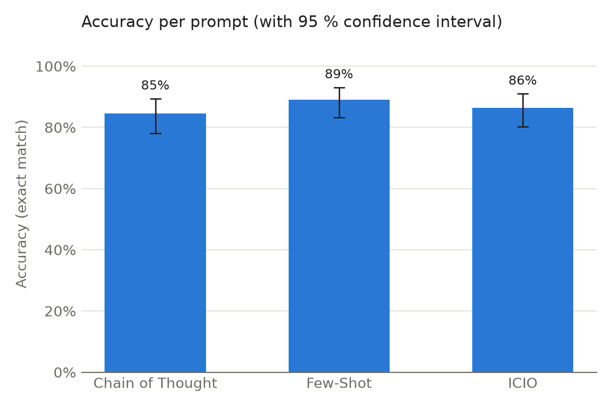
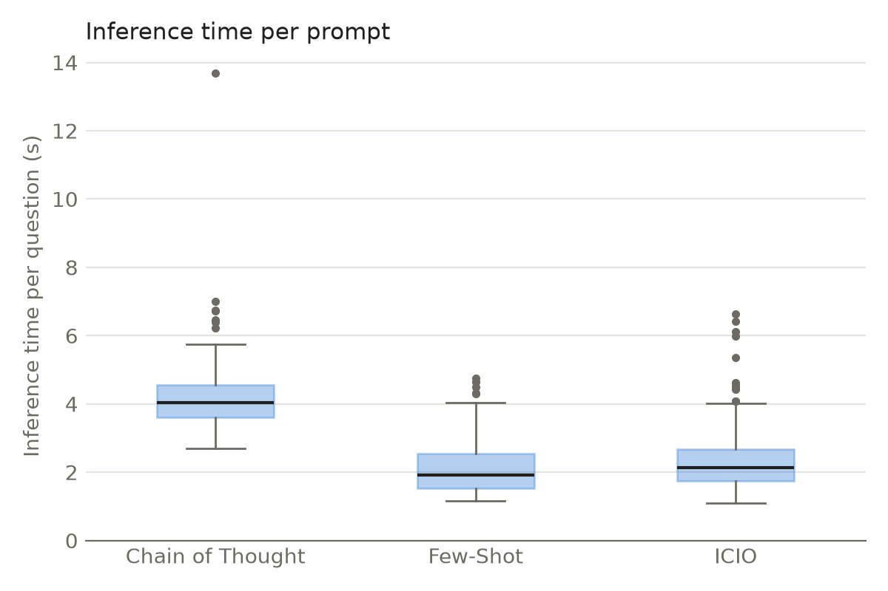

# Task 2: Running the prompts

## Setup

I ran the three prompts from Task 1 (Few-Shot, ICIO, Chain of Thought) on all 155 questions from `restaurants_dataset.csv`.

- Model: Claude Haiku (`claude-haiku-5-5`).

Each question was sent as a separate call. Every answer therefore comes from a new session that knows nothing about the previous questions or the other prompts. I switched off all tools, so the model could not look into the database or the files with the expected answers and had to answer from the prompt alone. I also replaced Claude Code's default system prompt with a single short sentence, so that the model only followed my prompt and not Claude Code's instructions for programming.

The script `run_prompts.py` sends the calls and stores the results. For every question it saves the question, the raw answer of the model, the SQL query taken from that answer, the prompt and framework, the model, the agent and its version, the inference time and the number of tokens. The results are in `predictions/predictions_<prompt>.csv`, and the complete responses from Claude Code are in `predictions/raw_<prompt>.jsonl`.

The script is started with `python run_prompts.py` (by default it reads `../Task_1/prompts.json` and `data/restaurants_dataset.csv` and uses Haiku). The three prompts were run at the same time in three separate processes (`--prompts few_shot`, `--prompts icio`, `--prompts cot`). Each call is still its own session, but the calls of the three prompts overlapped in time, so load on the server affected all three prompts in the same way.

For Few-Shot and ICIO the whole answer is the query (Markdown code blocks are removed if the model adds them). For Chain of Thought the query is the text after the last `SQL:` line.

The inference time is `duration_ms` reported by Claude Code. It is the time Claude Code spent on the request, almost all of it waiting for the API (the median difference between `duration_ms` and `duration_api_ms` is about 0.15 s). Starting the `claude` process for every call is not included: the wall-clock time measured by the script (`_wall_ms` in the raw files) is about 2.1–2.3 s longer for every prompt.

## Evaluation

The script `evaluate_prompts.py` computes accuracy the same way as `evaluate_retrieval_predictions.py`: a query is correct only if it returns exactly the expected rows. The only difference is that a query that can't be executed is counted as wrong. The original script stops at the first such query.

## Results

| Prompt | Accuracy (95 % CI) | Correct | SQL errors | Mean time (s) | Median time (s) | Mean input tokens | Mean output tokens |
|---|---|---|---|---|---|---|---|
| Few-Shot | 89.0 % (83.1–93.0 %) | 138 / 155 | 0 | 2.08 | 1.92 | 1771 | 246 |
| ICIO | 86.5 % (80.2–91.0 %) | 134 / 155 | 0 | 2.39 | 2.13 | 1818 | 315 |
| Chain of Thought | 84.5 % (78.0–89.4 %) | 131 / 155 | 0 | 4.20 | 4.04 | 2165 | 805 |

All three prompts worked well. The model answered between 131 and 138 of the 155 questions correctly, and none of the queries failed to execute, so the SQL was always taken from the answer correctly, including the Chain of Thought answers.

Few-Shot was the most accurate (89.0 %), followed by ICIO (86.5 %) and Chain of Thought (84.5 %). The differences are small, only 7 questions between the best and the worst prompt, and the confidence intervals overlap almost completely. From these numbers alone I can't say that one prompt is really better than the others. Whether the difference is significant is tested in Task 4.

The difference in time is much clearer. Chain of Thought took about twice as long per question as the other two prompts (4.2 s compared to 2.1 and 2.4 s), because it writes its reasoning before the query and generates about three times more output tokens (805 compared to 246 and 315). Few-Shot was the fastest and the cheapest. The measured times don't include starting Claude Code for every question, which added another 2.1–2.3 s per call for all prompts, so in wall-clock time the relative difference between the prompts is smaller.

The results are different from what I expected in Task 1. I expected ICIO and Chain of Thought to be more accurate than Few-Shot, but the simplest prompt did best. The examples already show the model how to write the queries, and the extra reasoning in Chain of Thought didn't help: it made the answers slower and slightly less accurate. This matches the note on the Frompting page that Chain of Thought is not well suited for tasks where the output has to follow a strict format.