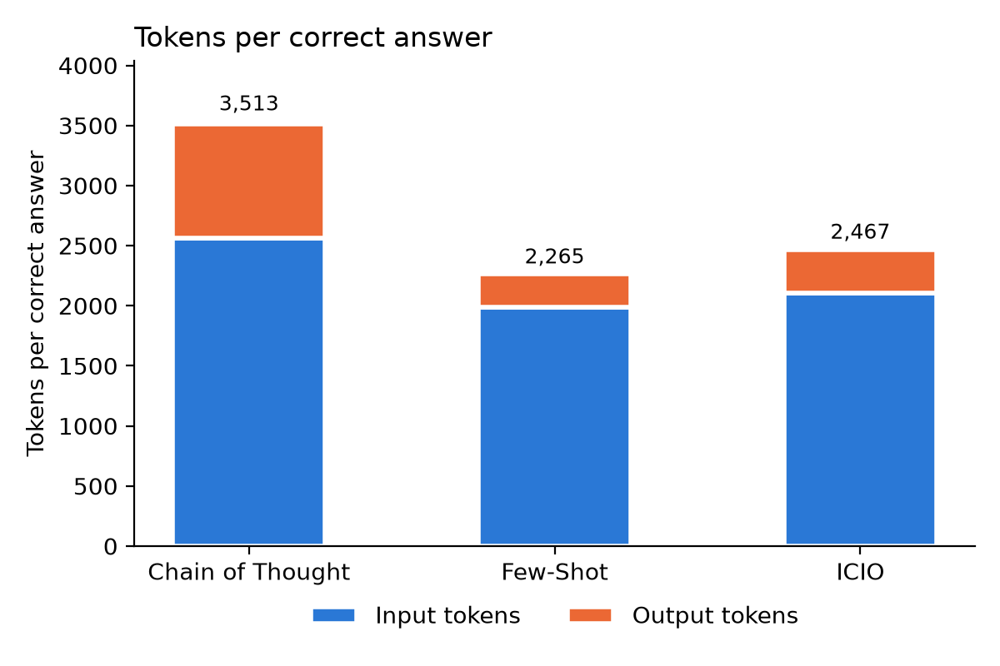

# Task 3: Tokens per Correct Answer

## The metric

**Tokens per Correct Answer (TPCA)** = all tokens used by a prompt (input + output, over all 155 questions) / number of correct answers. Lower is better.

**Why it is a good metric.** Accuracy says how often the model is right, but not what the right answers cost. TPCA combines both in one number: a prompt scores well only if it is accurate *and* cheap. Tokens spent on wrong answers count too, because they are also paid for. It needs no extra model runs, because the token counts were already stored in Task 2. It is also easy to read: "one correct answer costs about 2,300 tokens".

**Weaknesses.** It only compares prompts on the same model, because tokenizers and prices differ between models. It measures time only indirectly. It can't be computed when there are no correct answers.

**Complement or replacement?** It complements accuracy. If one prompt is clearly more accurate, it may be worth more tokens. If the accuracies are similar, as in Task 2, TPCA decides.

## Results

| Prompt | Correct | Total tokens | Tokens per correct answer | Output tokens per correct answer |
|---|---|---|---|---|
| Few-Shot | 138/155 | 312,631 | 2,265 | 276 |
| ICIO | 134/155 | 330,569 | 2,467 | 364 |
| Chain of Thought | 131/155 | 460,267 | 3,513 | 952 |

Few-Shot is the most efficient prompt. ICIO needs about 9 % more tokens per correct answer, and Chain of Thought about 55 % more. Looking at the output tokens alone, Chain of Thought spends more than three times as many per correct answer as Few-Shot, on reasoning that didn't produce more correct answers. With accuracy alone the prompts looked similar. TPCA shows a clear ranking: Few-Shot is both the most accurate and the cheapest.
