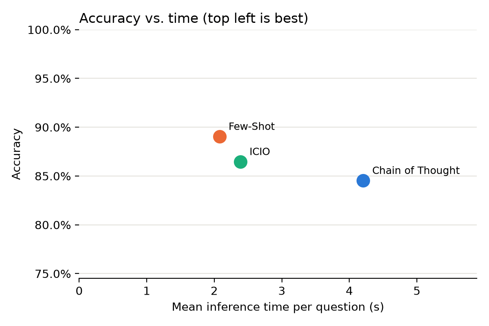
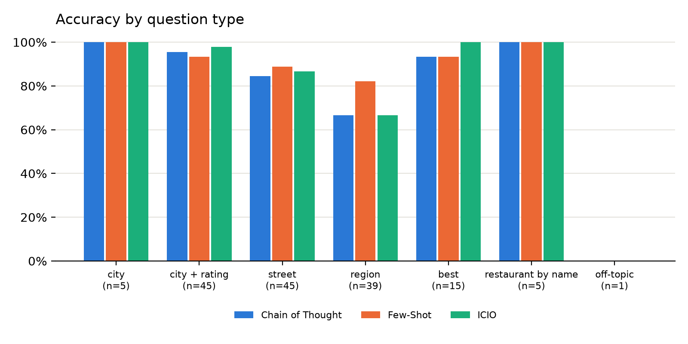
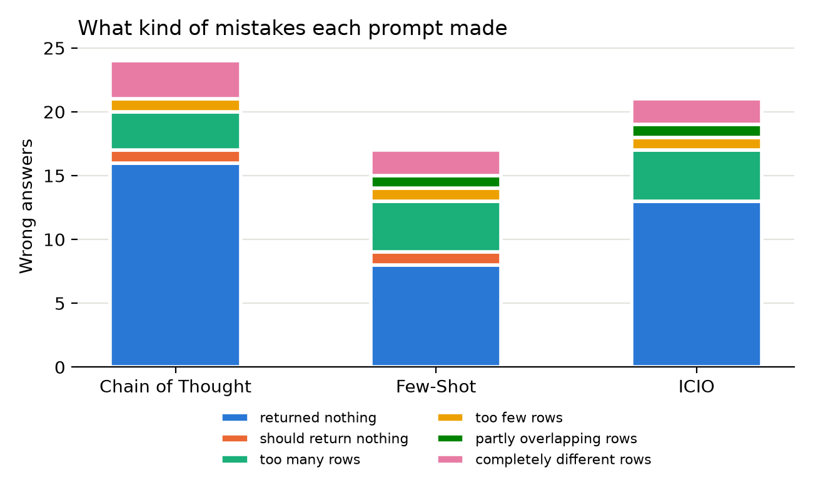

# Task 4: Detailed comparison of the prompts

## Overview

| Prompt | Correct | Accuracy | Mean time (s) | Mean output tokens | Tokens per correct answer |
|---|---|---|---|---|---|
| Few-Shot | 138/155 | 89.0 % | 2.08 | 246 | 2,265 |
| ICIO | 134/155 | 86.5 % | 2.39 | 315 | 2,467 |
| Chain of Thought | 131/155 | 84.5 % | 4.20 | 805 | 3,513 |

Few-Shot is the best prompt in every column, and Chain of Thought the worst.

## Statistical significance

All prompts answered the same questions, so I used paired tests (α = 0.05, pairwise p-values Holm-corrected).

**Accuracy.** Cochran's Q test over all three prompts: Q = 5.69, p = 0.058. Pairwise McNemar tests:

| Pair | Only first correct | Only second correct | p | p (Holm) |
|---|---|---|---|---|
| Chain of Thought vs Few-Shot | 1 | 8 | 0.039 | 0.117 |
| Chain of Thought vs ICIO | 2 | 5 | 0.453 | 0.688 |
| Few-Shot vs ICIO | 7 | 3 | 0.344 | 0.688 |

None of the differences in accuracy is significant. The prompts disagree on only 7–10 questions per pair, and that is too few to rule out chance.

**Time and tokens.** Wilcoxon signed-rank test per question, and a bootstrap (5,000 resamples) for tokens per correct answer:

| Pair | Median time diff. (s) | Median output token diff. | Tokens per correct answer diff. (95 % CI) |
|---|---|---|---|
| Chain of Thought vs Few-Shot | +2.04 | +574 | +1,248 (+1,100 to +1,428) |
| Chain of Thought vs ICIO | +1.85 | +493 | +1,047 (+920 to +1,198) |
| Few-Shot vs ICIO | -0.26 | -54 | -201 (-326 to -92) |

All of these differences are significant (every Wilcoxon p < 0.001, and no bootstrap interval contains 0).

**The prompts don't differ significantly in how often they are right, but they do differ in cost and time.**

## Where the mistakes are

| Question type | Questions | Chain of Thought | Few-Shot | ICIO |
|---|---|---|---|---|
| city | 5 | 5/5 | 5/5 | 5/5 |
| city + rating | 45 | 43/45 | 42/45 | 44/45 |
| street | 45 | 38/45 | 40/45 | 39/45 |
| region | 39 | 26/39 | 32/39 | 26/39 |
| best | 15 | 14/15 | 14/15 | 15/15 |
| restaurant by name | 5 | 5/5 | 5/5 | 5/5 |
| off-topic | 1 | 0/1 | 0/1 | 0/1 |
| with distracting text | 44 | 37/44 | 39/44 | 37/44 |
| without distracting text | 111 | 94/111 | 99/111 | 97/111 |

| Kind of mistake | Chain of Thought | Few-Shot | ICIO |
|---|---|---|---|
| returned nothing | 16 | 8 | 13 |
| should return nothing | 1 | 1 | 0 |
| too many rows | 3 | 4 | 4 |
| too few rows | 1 | 1 | 1 |
| partly overlapping rows | 0 | 1 | 1 |
| completely different rows | 3 | 2 | 2 |

- **Regions and streets are the hardest.** Few-Shot's lead comes almost entirely from region questions (32/39 vs 26/39).
- **The most common mistake is a query that returns nothing.** Chain of Thought and ICIO "interpret" names. They turn "the sacramento area" into the city `sacramento`, or shorten the street `w evelyn ave ste 108` to `w evelyn ave`, and then nothing matches. Few-Shot copies the names literally, which is what this dataset needs.
- **Distracting text hardly matters.** Accuracy is about the same with and without it, so ICIO's input markers gave no advantage.
- **Most mistakes come from the questions themselves.** 42 of the 62 wrong answers are on 14 questions that all three prompts got wrong. Examples are the ambiguous "the monterey" (both a city and a region in the database) and an off-topic question whose expected answer is 2,696 restaurants.

## Why the results are the way they are

**The prompt.** All three prompts share the same schema and examples, so they differ only in how the instructions are presented. That explains why the differences in accuracy are small. Few-Shot lets the model copy the examples directly. ICIO's extra rules and Chain of Thought's reasoning add interpretation that doesn't help with simple, convention-driven questions. Chain of Thought also costs about three times more output tokens, which matches Frompting's note that CoT doesn't suit strict output formats.

**The model.** Claude Haiku is a small model, and small models are good at copying examples, which favours Few-Shot. A larger model might gain more from the reasoning or the rules, so the ranking may differ with another model. The model is also not deterministic, and every prompt was run only once, so some disagreements between the prompts are random. That is another reason the accuracy differences aren't significant. The number of tokens the model generates determines the cost and most of the time differences.

**The coding agent.** Claude Code ran every question in a fresh session, with tools off and a minimal system prompt, so the model saw almost only my prompt. That keeps the comparison fair. Starting Claude Code adds about 2.2 s per call (not included in the measured times). That makes the 0.26 s gap between Few-Shot and ICIO irrelevant in practice, but not the 2 s extra for Chain of Thought. All input tokens were written to the prompt cache but never read from it, because every call was a new session. So in this setup the input part was slightly more expensive, and the differences between the prompts come mainly from the output tokens.

## Conclusion

With Claude Haiku in Claude Code, Few-Shot is the best prompt: it is the most accurate, the fastest and the cheapest. The accuracy differences are not significant. The time and cost differences are, and Chain of Thought is about twice as slow and needs 55 % more tokens per correct answer. Most errors come from ambiguous or off-topic questions rather than from the prompts. Repeated runs and more models would make the comparison stronger.
