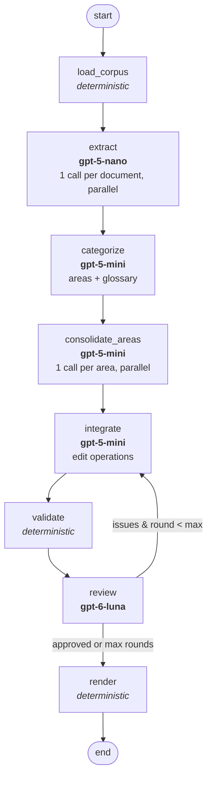

# Task 1 – Agentic Network for Requirements Refinement

## Deliverables

| File | Content |
|---|---|
| `requirements_graph.py` | The agentic network (LangGraph). |
| `requirements.md` | The generated requirements document for `data/corpus`. |
| `extraction_cache.json` | Cached output of the extraction step (lets later runs skip re-extraction). |
| `requirements.txt` | Pinned Python dependencies. |
| `REPORT.md` | This report. |

Run it with:

```bash
python -m venv .venv && .venv/bin/pip install -r requirements.txt
echo 'SCHOOL_OPEN_AI_API_KEY=sk-...' > .env
.venv/bin/python requirements_graph.py data/corpus -o requirements.md
```

The script only takes an **input directory**. It reads every text file in it recursively
(`.txt`, `.eml`, `.md`, …), so it works on any similar corpus. You can override each node's
model with `--<node>-model`, the loop limit with `--max-rounds` (default 4), and turn off the
extraction cache with `--cache ''`.

## 1. Architecture



| Node | Kind | Model | Responsibility |
|---|---|---|---|
| `load_corpus` | deterministic | – | Recursively loads all text files from the input directory. |
| `extract` | LLM | gpt-5-nano | Per document, extracts **every** atomic requirement candidate with a short name, a "The system shall…" statement, a verbatim evidence quote and any urgency hint ("CRITICAL", "nice to have"). Ignores small talk. Documents are processed in parallel. Each candidate gets an ID (`C001`…) and its source file is recorded. |
| `categorize` | LLM | gpt-5-mini | Splits all candidates into 6–14 non-overlapping functional areas and defines the canonical **glossary** (terms + synonyms to avoid). A deterministic safety net puts unassigned candidates into a "General" area. |
| `consolidate_areas` | LLM | gpt-5-mini | One call per area (chunks of ≤ 90 candidates), in parallel. Merges duplicates, resolves conflicts, assigns MoSCoW priority, writes name + paragraph in glossary vocabulary, and puts conflicting / nonsensical / non-software items on the blacklist. |
| `integrate` | LLM | gpt-5-mini | Works across all areas. It returns **edit operations** (merge, split, rewrite, discard, attach, add, restore) rather than rewriting the whole spec. Round 1 merges duplicates and resolves conflicts across areas. Later rounds fix the issues reported by `validate` and `review`. The edits are applied by Python code. |
| `validate` | deterministic | – | Checks coverage (every candidate is in a requirement or on the blacklist, never both), traceability (no requirement without sources), style ("The system shall", paragraph length), duplicate names and glossary synonyms. |
| `review` | LLM | gpt-6-luna | Independent critic. Checks duplicates, conflicts, vocabulary, atomicity, priorities, blacklist reasons and completeness against the full candidate list. It either approves or returns ≤ 15 concrete issues. |
| `render` | deterministic | – | Assigns final IDs (`REQ-001`…), works out source documents from candidate IDs, and writes the Markdown document. |

## 2. Design choices

**Extract → consolidate in two stages instead of one big prompt.** The corpus contains
20 documents (~145 kB). Extracting per document keeps each prompt small, so even the
cheapest model can extract exhaustively. Having one model also merge and deduplicate in the
same pass would mean it never sees the other documents. Running extraction in parallel also
makes it fast.

**Consolidation partitioned by functional area.** My first version consolidated all 555
candidates in one `gpt-5-mini` call. It failed in three ways:

- It produced only 19 heavily bundled requirements.
- It used the blacklist as a dumping ground for "duplicates".
- 165 candidates ended up assigned twice.

The model simply cannot keep track of hundreds of IDs at once. Partitioning by functional
area solves this. Duplicates of the same need land in the same area, so they can still be
merged, and each call stays small (≤ 90 candidates). The few duplicates that span areas are
handled by `integrate`.

**Edit operations instead of regeneration.** In the feedback loop, regenerating a
140-requirement spec each round is slow and expensive, and every regeneration can introduce
new errors and drop traces. Instead, the integrator returns a small `EditPlan` that Python
applies. Requirement keys (`R###`) stay stable across rounds, so the reviewer's
comments ("R012 and R044 overlap") remain valid. Splits deterministically keep every source
candidate, so a trace can never be lost.

**Traceability is computed, not generated.** LLMs only ever reference candidate IDs. The
source documents and the final `REQ-###` numbers are worked out in code from those IDs. This
makes tracing (OS4) reliable even with weaker models, which might otherwise invent file names.

**Structured output everywhere.** Every LLM node uses Pydantic schemas with OpenAI strict JSON
mode (`with_structured_output`), so there's no fragile text parsing. Strict mode doesn't allow
free-form dictionaries, which is why the glossary is a list of `{term, definition, avoid}`
objects.

**Model choice (cost vs. capability).**
- `gpt-5-nano`: extraction. It's the highest-volume step (20 calls) and the simplest task.
- `gpt-5-mini`: categorization, consolidation and integration. These are mid-complexity
  reasoning tasks on medium-sized inputs.
- `gpt-6-luna`: the reviewer. The strongest model is used as the critic because a loop is
  only as good as its judge, and because a *different* model from the generator avoids it
  approving its own mistakes.

**Two kinds of checks in the loop.** `validate` (deterministic) catches problems that can
be checked exactly and cheaply, such as coverage, traceability, format and duplicate names.
`review` (LLM) catches semantic problems like duplicates in meaning, conflicts and vague
wording. Both sets of issues are fed to `integrate` together. The loop stops when the
reviewer approves and no blocking validator issues remain, or after `--max-rounds`.

**Extraction cache.** The extraction output is cached in `extraction_cache.json`, keyed by the
list of documents. This let me iterate on the downstream nodes without paying for and waiting
on 20 extraction calls each time.

## 3. Specification coverage

### Agentic network specs

| Spec | How it is met |
|---|---|
| ANS1 ≥ 3 LLM nodes | 5 LLM nodes: `extract`, `categorize`, `consolidate_areas`, `integrate`, `review`. |
| ANS2 ≥ 1 deterministic node | 3 deterministic nodes: `load_corpus`, `validate`, `render`. |
| ANS3 feedback loop | `integrate → validate → review →` (conditional edge) `→ integrate`, up to `--max-rounds`. |
| ANS4 ≥ 3 models | `gpt-5-nano`, `gpt-5-mini`, `gpt-6-luna`. |
| ANS5 LangGraph | `StateGraph` with typed state, conditional edge `route_after_review`. |

### Output specs

| Spec | Addressed by |
|---|---|
| OS1 single structured document | `render` writes one Markdown file with fixed sections: priority scale, glossary, overview table, requirements by area, blacklist, traceability matrix, refinement log, open issues. |
| OS2 unique IDs | `render` assigns `REQ-###` deterministically. The blacklist uses `D-###`. |
| OS3 no duplicates | Merging inside each area (`consolidate_areas`), across areas (`integrate`, round 1), the duplicate-name check in `validate`, and the duplicate criterion in `review`. |
| OS4 tracing | Each requirement lists its `candidate_ids`. `render` maps these to source documents ("Sources" line + traceability matrix in section 6). |
| OS5 name + paragraph | `STYLE_RULES` in the prompts. `validate` checks for "The system shall…" and a minimum paragraph length. |
| OS6 priority + scale | MoSCoW scale defined in `PRIORITY_SCALE`, injected into prompts, printed in section 1 with counts. Each requirement has a priority rationale. |
| OS7 consistency | Glossary from `categorize`, used by every later prompt. Synonym check in `validate`. Conflict detection in `consolidate_areas`, `integrate` and `review`. |
| OS8 completeness | Exhaustive extraction prompt. `categorize` safety net. `validate` makes sure every candidate is either used or blacklisted. `review` compares against the full candidate list. |
| OS9 blacklist | `BLACKLIST_RULES`: only conflict / nonsensical / not-software items, each with a reason (conflicts name the winner). Duplicates may never be blacklisted. Printed in section 5 with sources. |

## 4. Results on the provided corpus

Final run (`requirements.md`), with extraction loaded from the cache:

| Stage | Result |
|---|---|
| `load_corpus` | 20 documents |
| `extract` | 555 candidate requirements |
| `categorize` | 10 functional areas, 11 glossary terms, 0 unassigned candidates |
| `consolidate_areas` | 155 requirements, 10 blacklisted |
| Loop round 1 | 37 edits (15 merges, 15 attaches, …) → 138 requirements · validator 8 issues · reviewer 10 issues |
| Loop round 2 | 26 edits → 139 requirements · validator 1 · reviewer 8 |
| Loop round 3 | 16 edits → 139 requirements · validator 1 · reviewer 8 |
| Loop round 4 | 15 edits → 138 requirements · validator 2 · reviewer 10 |
| **Output** | **138 requirements** (92 Must, 38 Should, 8 Could) in 11 areas, **11 blacklisted** (3 conflicts, 8 non-software), **10 glossary terms**, 555/555 candidates accounted for |

What the document looks like:

- Every requirement has an ID, a Title Case name, a "The system shall…" paragraph with a
  verification sentence, type, priority with rationale, and its source documents.
- Every one of the 20 input documents contributes at least one requirement (traceability
  matrix in section 6).
- The glossary has one entry per concept. For example, *Item* absorbs "copy" and
  "volume entry", and *Report Template* describes canned / on-demand / open templates as
  subtypes instead of separate terms.
- The blacklist contains three conflicts. One is a sysadmin's wish to keep all reporting data
  in the main database, which contradicts the better-supported separate reporting warehouse.
  Another is "exclude last circulation date", which contradicts the requirement to report it.
  The other 8 items are project-management actions from meeting minutes ("establish a
  testing group", "develop a list of requirements"), which are correctly identified as not
  software requirements. Small talk in the emails (e.g. a question about Costco opening
  hours) was already ignored during extraction.
- The reviewer did not give final approval within 4 rounds. Its remaining 10 issues are
  listed in section 8 of the document. They're substantive but narrow: two remaining
  overlaps, one privacy conflict around the transaction archive, missing protection against
  deleting a last copy, and a few canned reports not mentioned explicitly. These would be the
  input for a human analyst's final pass.
- One validator issue remains in section 8: three candidates ended up both in a requirement
  and on the blacklist after the last round. I added a deterministic rule for this case
  afterwards (a candidate that still supports a kept requirement is removed from the
  blacklist entry, which keeps it as a related source). The submitted document was generated
  just before that rule was added.

### Iterations during development (lessons learned)

| Version | Problem observed | Fix |
|---|---|---|
| v1: one consolidation call for all candidates | 19 bundled requirements; blacklist used as a dump for "duplicates"; 165 double-assigned candidates | Split by functional area (`categorize` + parallel `consolidate_areas`) and add a cross-area `integrate` node |
| v1 | Loop regenerated the full spec each round, so IDs changed and traces were lost | Loop edits the spec through `EditPlan` operations applied in code |
| v2 | Glossary "avoid" lists banned normal words (*user*, *library*) and even other glossary terms (Item ↔ Copy) | Prompt rule + deterministic `clean_glossary`; vocabulary warnings made non-blocking |
| v2 | The last loop round could add requirements with no sources, or both use and blacklist a candidate | Code rejects untraceable additions; an explicit blacklisting detaches the candidate |
| v2 | Internal candidate IDs ("(C229)") leaked into the text | Prompt rule + `strip_ids` in `render` |
| v3 | Glossary had overlapping entries (*Template*, *Template (Open)*, *Template (Standard)*, …; *Item* vs *Copy*) | `GLOSSARY_RULES` in the prompts (one entry per concept, subtypes inside the definition), deterministic `glossary_overlaps` check in `validate`, glossary criterion in `review`. The glossary went from 15 overlapping terms to 10 distinct ones |
| v3 | Discarding a requirement whose sources also support another requirement left candidates both used and blacklisted | Deterministic rule: the kept requirement wins; the blacklist entry keeps the candidate as a related source |
| all | OpenAI strict JSON mode rejects free-form dicts | Glossary modelled as a list of objects |

## 5. Limitations and possible improvements

- **Extraction granularity varies by document.** The long SRS draft yields many very
  fine-grained candidates, which makes some areas larger than others. A second extraction
  pass, or a stronger extraction model, would make candidates more uniform.
- **Final approval is not guaranteed.** The reviewer usually keeps finding smaller issues.
  Anything left open after the last round is printed in section 8 of the document rather than
  hidden.
- **Runs are not deterministic.** The LLM outputs vary, so a rerun gives a somewhat
  different document (the number of areas and requirements changed between my runs, e.g.
  7 areas / 126 requirements vs. 14 areas / 166 requirements). The deterministic checks keep
  the guarantees (coverage, traceability, IDs) the same across runs.
- **The vocabulary check is lexical.** It flags synonyms by regex, so it can produce false
  positives. That's why these warnings are non-blocking.
- **The 2009 corpus contains obsolete technical constraints** (IE 6, PostgreSQL 8.3). The
  network blacklists them as conflicting with the more general platform requirements. A
  human analyst might keep them as historical constraints instead.
