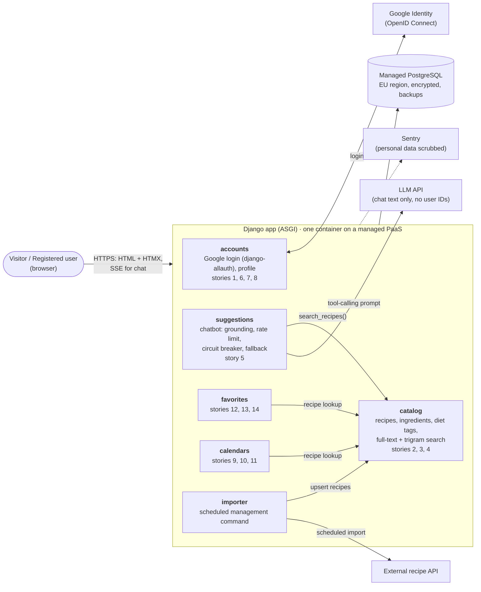

# ADR-001: Build RecipeCove as a single Python (Django) modular monolith

- **Status:** Accepted
- **Date:** 2026-10-29
- **Deciders:** RecipeCove developer (solo)
- **Source:** architecture discussion in `Week_05_Designing/Task_1/notes.md` (detailed analysis of each option in its section 3); requirements in `Week_05_Designing/Tasks/data/RecipeCove.txt`

## Summary

- **Decision:** RecipeCove is built as **one Django application** with strictly separated modules, one PostgreSQL database and one deployment. The LLM chatbot is one of its modules.
- **Why:** with a single developer, it is the only option that keeps effort low while giving a fast, consistent user experience. Microservices and serverless fail on effort, privacy, relational data or lock-in.
- **Main trade-off:** a separate chatbot service would isolate the chatbot better, but it doubles the codebases. Instead, the chatbot is protected inside the app with timeouts, a fallback and cost limits.
- **Chatbot:** grounded in our catalogue. It can only suggest recipes returned by a SQL search, by ID.
- **GDPR:** one database makes data export and account deletion a single operation. Chat conversations aren't stored, because they can reveal health or religion. A "delete my account" story must be added to the requirements.
- **Revisit:** extract the chatbot into its own service if the team grows or the chatbot starts affecting the rest of the site.

## Context and Problem Statement

RecipeCove is a web application for discovering, viewing and bookmarking recipes. The 14 user stories cover:
- Google-only sign-in, login and logout
- search by recipe name
- recipe and ingredient detail pages
- a diet-aware chatbot that suggests recipes
- a profile page
- a favorites list
- a personal calendar with recipe reminders

We need to choose the overall system architecture.

The requirements don't specify a data source, scale, chatbot technology or team, so we work from these assumptions:
- Recipes and ingredients are **imported** from a third-party recipe API into our own database by a scheduled job.
- The chatbot is **LLM-based** and must only suggest recipes that exist in our catalogue (grounded).
- The calendar is **internal** to the app (no Google Calendar sync).
- About **10k registered users**, at most a few hundred at once, mostly reading.
- **One developer**, about one semester.
- EU users, so **GDPR** applies (e.g. calendar deletion is a hard delete).
- Users are identified by Google's stable `sub` claim.

## Decision Drivers

1. **Effort:** keep the amount of code, technology stacks and operational work manageable for one person.
2. **Seamless UX:** fast pages, actions visible immediately, no random failures, no downtime on deploys.
3. **Relational data:** users ↔ favorites ↔ recipes ↔ ingredients ↔ diet tags, with filtering and joins.
4. **LLM chatbot:** it is slow, external, paid per call and open to anonymous visitors. It must not drag down the rest of the site, and Python is its natural ecosystem.
5. **Privacy:** reliable deletion of user data.
6. **Running cost:** low and predictable.
7. **Evolvability:** it must be possible to split out the chatbot later without a rewrite.

## Considered Options

1. **Modular monolith in Python/Django**, with the chatbot as an internal module
2. **Modular monolith + separate Python chatbot service**
3. **Microservices:** API gateway, one service per domain, message broker
4. **Serverless / Backend-as-a-Service:** static SPA, Firebase Auth, Firestore, Algolia, cloud functions

### Comparison against the decision drivers

| Decision driver | 1. Django monolith | 2. Monolith + chatbot service | 3. Microservices | 4. Serverless / BaaS |
|---|---|---|---|---|
| 1. Effort for one developer | ✅ One codebase, one deploy | ⚠️ Two codebases, two CI pipelines, internal API contracts, service auth | ❌ About 6 services, a broker, several DBs, distributed tracing | ⚠️ Almost no ops, but logic scattered across security rules, functions and client; one rule mistake exposes all users' data |
| 2. Seamless UX | ✅ Predictable latency, immediate consistency | ✅ Same; the extra hop is negligible next to LLM time | ⚠️ Network chains; eventual consistency (search lags behind, outbox needed) | ⚠️ Cold starts; copied recipe data goes stale |
| 3. Relational data | ✅ SQL joins, transactions | ✅ Same (the chatbot owns no data) | ⚠️ Favorites need recipe titles from another service | ❌ NoSQL: no joins, limited filters |
| 4. LLM chatbot | ⚠️ Python, but isolation only in-process | ✅ Python + process isolation | ✅ Python + process isolation | ⚠️ Function timeouts make streaming hard |
| 5. Privacy / GDPR deletion | ✅ One DB transaction | ✅ One DB transaction | ❌ Saga across services; JWT logout not instant | ⚠️ Sub-collections must be deleted manually |
| 6. Running cost | ✅ Low, fixed | ⚠️ Two containers | ❌ High | ⚠️ Near zero, but unpredictable |
| 7. Evolvability | ✅ Module boundaries allow extracting the chatbot | ✅ Already split | ✅ Already split | ❌ Vendor lock-in |
| **Verdict** | **Chosen** | Rejected for now; future path | Rejected | Rejected |

Legend: ✅ meets the driver well · ⚠️ partially, or with notable cost · ❌ poor fit

## Decision Outcome

**Chosen option: 1 — a single Python/Django modular monolith.**

**Rationale:**
- Options 3 and 4 are ruled out by their ❌ ratings: option 3 on effort, privacy and cost (drivers 1, 5, 6), option 4 on relational data and evolvability (drivers 3, 7).
- That leaves options 1 and 2, the only options without a ❌. They differ on three drivers:
  - Option 1 is better on **effort** (driver 1) and **running cost** (driver 6).
  - Option 2 is better on **chatbot isolation** (driver 4).
- Option 1 wins this trade-off for two reasons:
  - With one developer, effort is the dominant driver.
  - Option 1's only ⚠️ (driver 4) is mitigated by the in-process safeguards described below.

**Architecture diagram:**

Arrows inside the app are calls through each module's `services.py`. Nothing outside the box can reach the database.

**Design in brief:**
- **Module boundaries:** modules call each other only through each module's `services.py` (enforced, see Confirmation).
- **Frontend:** server-rendered Django templates + HTMX. No separate SPA.
- **Chatbot grounding:**
  - The LLM calls a read-only `search_recipes` tool, which runs as SQL against our catalogue.
  - The LLM returns only recipe IDs. The app validates them and renders recipe cards from the database.
  - Hard constraints such as the diet are enforced in SQL, not by the LLM.
- **Chatbot isolation inside the process:**
  - The app runs under ASGI, and the chat view streams the answer asynchronously (SSE), so a slow LLM call doesn't block other requests.
  - LLM calls have a timeout and a circuit breaker, with a fallback to plain diet-based suggestions from the database.
  - Per-visitor rate limits and a daily cost cap.
- **Deployment:** one container on a managed PaaS + managed PostgreSQL with backups, zero-downtime deploys, Sentry and an uptime check.

### Privacy and GDPR

The architecture doesn't make RecipeCove GDPR-compliant by itself, but it makes compliance cheap. These are the points that follow from *this* decision. The full mapping to GDPR articles, the data inventory and the residual risks are in [`privacy-gdpr.md`](privacy-gdpr.md).

- **Erasure and export (Art. 17, 15/20):** one database lets "Delete my account" cascade in one transaction, and lets each module's `export_user_data()` in `services.py` combine into one JSON export. With microservices, both would need a cross-service saga.
- **Chat data is special-category data (Art. 9):** diets can reveal health ("diabetic") or religion ("halal"). Conversations are therefore per-session only, not linked to the account and not stored.
- **The chatbot never sees user data (Art. 25):** its tool reads only the public catalogue, and only text without user identifiers is sent to the LLM.
- **Processors (Art. 28, 44+):** the hosting/DB provider (EU region), the LLM provider and Sentry (personal data scrubbed) each need a DPA. US providers also need DPF or SCCs.
- **Requirement gap:** the user stories have no "delete my account" story. It must be added.

### Consequences

**Good** (in addition to the ✅ in the table):
- Local development is just `runserver` plus one Postgres.
- Django admin provides a free UI for fixing recipe data. This covers the missing admin stories.
- django-allauth handles the error-prone OIDC details (state, nonce, token validation).

**Bad:**
- A severe bug, such as a memory leak, can take the whole site down. The in-process safeguards only cover the LLM failing, not the app itself.
- The whole application scales as one unit, and the chatbot cannot be deployed separately.
- Postgres search will need relevance tuning.
- Async streaming adds complexity: ASGI configuration, disabling SSE buffering on the platform, and cancelling the LLM call when the user disconnects.

### Confirmation

- `import-linter` in CI fails the build if a module imports another module's internals.
- A chatbot evaluation set (about 50 prompts, including prompt-injection attempts) runs in CI. It checks that every suggested recipe ID exists and satisfies the requested filters.
- The chatbot fallback is tested by simulating LLM timeouts and errors.
- A test creates a user with data in every module, deletes the account, and asserts that no row referencing the user remains in any table.
- A test checks that `export_user_data` covers every model holding a user foreign key, so a new module can't silently skip the export.

## More Information

**When to revisit this decision:**
- Move to **option 2** (extract the chatbot into a FastAPI service) if:
  - the team grows,
  - the chatbot needs its own scaling or heavy ML,
  - or chatbot crashes or deploys start affecting the main site.
- The extraction would work like this:
  - The `suggestions` module's public function (`suggest(messages)` → streamed text + recipe IDs) becomes `POST /v1/chat` (SSE).
  - The catalogue search becomes an internal `GET /v1/internal/recipes/search` endpoint.
  - The browser keeps talking only to the main app.
- Reconsider **option 4** only if the project turns into a short-lived demo, or traffic becomes tiny and spiky.
- Reconsider **option 3** only with many independent teams or an order-of-magnitude change in scale.
