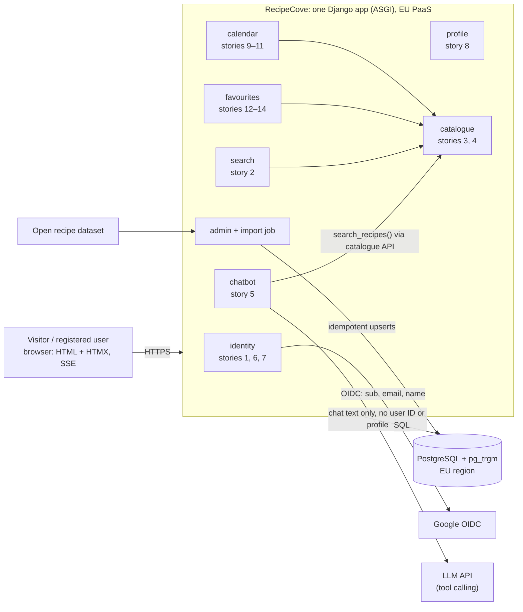

# ADR-001: Build RecipeCove as a single Python (Django) modular monolith

- **Status:** Accepted
- **Date:** 2026-10-29
- **Deciders:** Project owner (solo developer), with Claude Code
- **Source:** `../Task_1/notes.md` (sections 3–4 have the detailed analysis of each option, section 9 the chatbot deep dive); `Week_05_Designing/Tasks/data/RecipeCove.txt`

## Summary
- **Decision:** one Django application with strict internal modules, one PostgreSQL database in the EU, and server-rendered pages with HTMX.
- **Why:** it's the only option with ✅ on effort, the chatbot, data shape and privacy, the drivers that matter most for one developer.
- **Main trade-off:** the whole app scales and fails as one unit. We accept this at the expected scale of a few thousand users.
- **Chatbot:** an LLM with tool calling against a narrow, read-only catalogue search. It may only suggest recipes that exist in the DB and match the diet, and it falls back to plain SQL suggestions.
- **Compliance:** a single EU database makes erasure and export simple. The requirements have **no story for account deletion or data export**, and we add both.
- **Revisit:** extract the chatbot first, if it needs separate scaling or cost control or gets its own owner.

## Context and Problem Statement
RecipeCove is a web app for discovering, saving and reading about recipes. Its 14 user stories cover:
- Google sign-in, login and logout (1, 6, 7)
- search by recipe name (2) and a diet-specific recipe chatbot (5)
- recipe and ingredient pages (3, 4)
- profile (8), favourites (12–14) and an in-app calendar of recipe reminders (9–11)

We need to choose the overall architecture. The requirements don't state the following, so we assume:
- **one developer** builds and operates the system;
- the recipe catalogue is **imported once into our own DB** from an open dataset;
- the chatbot is a **real LLM that must stay grounded in the catalogue**;
- **hundreds to a few thousand EU users**, steady traffic, so GDPR applies;
- the calendar is in-app only, and the developer is the only content admin.

## Decision Drivers
1. **Effort:** one person must be able to build, deploy and operate it.
2. **Seamless UX:** fast pages, a saved change visible immediately, a chatbot that streams instead of freezing.
3. **Data shape:** favourites and calendar events reference recipes, so the data is relational.
4. **Grounded LLM chatbot:** the central feature, and the riskiest one.
5. **Privacy:** erasure, export and data location are easy to get right.
6. **Running cost:** low and predictable.
7. **Evolvability:** parts can be extracted or replaced later without a rewrite.

## Considered Options
1. **Modular monolith in Python (Django)**
2. **Microservices** (identity, catalogue, search, chatbot, user data; gateway + broker)
3. **Serverless / BaaS** (static SPA, Supabase auth + DB, hosted search, a function for the chatbot)
4. **Hybrid:** a monolith in another stack + a separate Python chatbot service

### Comparison against the decision drivers

| Decision driver | 1. Modular monolith | 2. Microservices | 3. Serverless / BaaS | 4. Hybrid |
|---|---|---|---|---|
| 1. Effort | ✅ one deploy. Django ships auth, admin and migrations. | ❌ 5 services, gateway, broker, 4 DBs, N pipelines | ✅ almost no servers to operate | ⚠️ two deploys, two CI pipelines and an HTTP contract to maintain |
| 2. Seamless UX | ✅ in-process calls, ACID. ASGI + SSE stream the chatbot. | ⚠️ search is eventually consistent. Network hops add latency. | ⚠️ cold starts add 0.5–2 s to the chatbot | ✅ only the chatbot call crosses the network |
| 3. Data shape | ✅ real joins (favourites ↔ recipes) | ❌ no cross-service joins: N+1 calls or synced copies | ✅ one Postgres | ✅ the main app owns all relational data |
| 4. Grounded LLM chatbot | ✅ Python LLM SDK. Tool runs SQL in-process. | ✅ isolated, scales on its own | ⚠️ gateway timeouts (~29 s) and response buffering | ✅ isolated Python service |
| 5. Privacy | ✅ erasure and export in one DB transaction | ⚠️ erasure is a saga across several DBs | ⚠️ more processors. One loose RLS rule exposes data. | ✅ the chatbot service stores no user data |
| 6. Running cost | ✅ one container + one managed DB | ❌ many always-on components + broker | ⚠️ free tier, but usage-based bills on spikes | ⚠️ two always-on services |
| 7. Evolvability | ⚠️ scales as one unit. Extraction relies on enforced module boundaries. | ✅ independent deploy and scaling | ❌ logic tied to vendor auth, RLS and functions | ✅ chatbot already separate |
| **Verdict** | **Chosen** | Rejected | Rejected | Rejected for now; it is the future extraction path |

Legend: ✅ satisfies the driver · ⚠️ partly, or with a known cost · ❌ fails it. Drivers aren't equally weighted, so there are no scores.

## Decision Outcome
**Chosen option: 1, a modular monolith in Python (Django).**

**Rationale** (derived from the table):
- **Option 2 is eliminated** by ❌ on drivers 1, 3 and 6. Its strengths (drivers 4 and 7) matter only with several teams or uneven load, and we have neither.
- **Option 3 is eliminated** by ❌ on driver 7 (vendor lock-in) and by ⚠️ on driver 4. That ⚠️ puts the central feature on the platform's weakest spot (timeouts and buffering, on top of the cold starts under driver 2).
- **Options 1 and 4 remain.** Neither has a ❌, and they differ only on drivers 1, 6 and 7. Option 1 has ✅ on 1 and 6, where option 4 has ⚠️. Option 4 has ✅ on 7, where option 1 has ⚠️.
- **Option 1 wins that trade-off.** For a solo developer, driver 1 outweighs everything else. Option 4 exists only to use Python for the chatbot, and writing the whole monolith in Python gets that without a second service. The ⚠️ on driver 7 is mitigated by enforced module boundaries (see Confirmation) and by the chatbot interface below, which is already shaped like an HTTP contract.

**Architecture diagram:**

Arrows inside the app are calls through each module's public `services.py` API. Arrows leaving the app are network calls. *(This diagram hasn't been render-tested; no Mermaid CLI is available here.)*

**Design in brief:**
- **Boundaries:** each module exposes only `services.py`. Importing another module's models or views is forbidden. Enforcement: see Confirmation.
- **Frontend:** Django templates + HTMX for favourites and calendar actions. No SPA build.
- **Chatbot:** the module interface is `suggest_recipes(diet, message, history) -> list[recipe_id]`. Internally, the LLM may call one read-only tool, `search_recipes(diet, include_ingredients, exclude_ingredients, max_prep_minutes, limit)`. `diet` is an enum, and SQL enforces the hard constraints. The reply is validated: every recipe ID must have been returned by the tool. Recipe cards are rendered from DB data, never from LLM text. At most 2 tool calls per message. Responses are streamed over SSE. Per-user and per-IP rate limits apply, with a lower quota for visitors. On timeout or error, the plain SQL list for the chosen diet is shown.
- **Data:** the catalogue import parses free-text ingredients into quantity, unit and a normalized name, keyed on `source_id`. Diet tags are derived from ingredients and reviewed in the admin UI. Calendar events use a `DATE` column.
- **Auth:** django-allauth (state, PKCE, nonce, ID-token validation). Users are keyed on the Google `sub`. Server-side sessions, so logout (story 7) is immediate.
- **Deployment:** one container on an EU PaaS + managed Postgres with backups. GitHub Actions: tests and checks → image → rolling deploy behind a health check. Migrations follow expand → migrate → contract.

### Privacy and GDPR
This architecture makes GDPR compliance easier, but it doesn't guarantee it. Process and legal work remain; see [privacy-gdpr.md](privacy-gdpr.md). The architecture-dependent points:
- **One EU database** holds all personal data, so erasure (Art. 17) and export (Art. 15/20) are each one transaction or query, plus a backup retention period.
- **Apart from the hosting providers (PaaS and DB), the LLM provider is the only processor that sees user content.** It receives chat text only: no user ID, email or profile. That still needs a DPA and a check for transfers outside the EU (Art. 28, 44+).
- **Chat messages may reveal health or religious information** ("I'm coeliac", "halal"), which is special-category data under Art. 9. They are kept server-side for 30 days only and never joined to the profile.
- **Requirement gap:** story 10 deletes a calendar, but no story covers **deleting the account** or **exporting data**. We add both as stories 15 and 16.

### Consequences
**Good** (in addition to the ✅ in the table):
- One log stream and one debugger session cover the whole request path.
- The Django admin gives the catalogue curation (diet-tag review) a UI at no extra cost.

**Bad:**
- A memory leak or a bad deploy takes the whole site down, including search, which doesn't depend on the LLM.
- Module boundaries are only as strong as the linter contract. Shared DB tables can still couple modules through migrations.
- Grounding guarantees that recipes exist and match the diet *tag*. It does **not** catch a wrong tag from the import, or wrong cooking advice in the LLM's free text.
- The LLM cost depends on visitor traffic, and rate limits only cap it.

### Confirmation
- **Boundary linter:** an import-linter contract in CI fails the build when a module imports another module's internals.
- **Chatbot evaluation set:** about 50 fixed prompts with property checks (every suggested ID exists, matches the diet, and none is invented), run in CI against a recorded or mocked LLM, and weekly against the live one.
- **Fallback test:** with the LLM client forced to time out, story 5 still returns SQL suggestions.
- **Deletion test:** after deleting an account, no rows referencing that user remain in any table.
- **Export test:** the export includes every table that has a `user_id` column (checked through schema introspection, so new tables can't be missed).

## More Information
**When to revisit:**
- **Extract the chatbot** (a split like option 4, but with the main app staying in Python) when its load or LLM cost needs separate scaling or limits, when prompt or model changes need their own deploy cadence, or when a second developer takes ownership. `suggest_recipes(...)` becomes `POST /suggest` with the same input and output (recipe IDs). The tool calls a read-only catalogue endpoint or a read replica.
- **Move to a dedicated search engine** if pg_trgm relevance (synonyms, ranking) or latency falls short.
- **Consider option 2** only with several teams or parts with very different scale. **Consider option 3** only if the LLM chatbot is dropped and nobody wants to run a backend.
